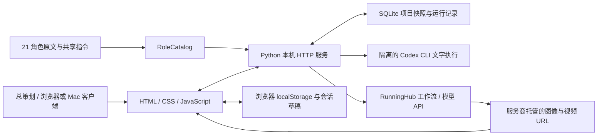

# 技术架构与开发维护

盘点日期：2026-10-25。本文描述交接时磁盘上的代码，不代表所有外部模型均已实测。交付包逐文件数量和校验值以同目录 `清单/全部文件清单.csv`、`清单/全部文件清单.json` 为准。

## 1. 系统组成

以下描述本机单用户工作台架构；另有独立的云端 BYOK 版本（见本节末尾）。本机运行方式：原生 HTML/CSS/JavaScript 页面连接 Python 回环 HTTP 服务；SQLite 保存项目与执行记录；文字任务通过本机已登录的 Codex CLI 执行；图片与视频通过 RunningHub API 提交。Mac 客户端是同一网页的 AppKit + WKWebView 外壳。



这里的“团队”是角色化的软件协作，并非 21 个一直独立在线的真人或无限并行进程。角色能力说明、运行权限、实际工具连接与真实产出必须分开判断。

## 2. 前端模块

当前 `lib/` 有 12 个 JavaScript 模块，其中 11 个由主页面加载；`lib/media-posters.js` 尚未接线。

| 文件 / 目录 | 主要职责 | 维护注意事项 |
|---|---|---|
| `index.html`、`app.js` | 页面壳、脚本装载、事件派发、表单、对话框、媒体和画布交接 | `app.js` 是交互编排中心；不要另建第二份项目状态 |
| `lib/views.js` | 首页、项目、任务、成员、素材、连接与各种表单的 HTML | 动态内容统一转义；示例视觉与真实媒体成果分开 |
| `lib/store.js` | v3 工作台状态、字段归一化、任务依赖、决策、项目创建与主展示选择 | 新项目字段必须同时加入创建和 `normalize()`；只修改表单会在回读时丢失 |
| `lib/workspace-sync.js` | 浏览器状态与数据库快照同步、版本比较、冲突与备份 | 写入采用预期版本；发生冲突不静默覆盖任一方 |
| `lib/runtime.js` | 本机服务、角色、会话、运行、媒体、回收站的客户端状态 | API 错误、离线和未验证状态应保持可见 |
| `lib/production.js`、`lib/production-views.js` | 自动协作请求、进度、阶段结果、审阅与返修视图 | 草稿、项目默认方式和最近一轮方式有继承关系 |
| `lib/canvas.js` | 横向画布、节点编辑、人物资产、提示词弹窗、生成批次与结果 | 保持项目、角色、镜头、来源版本与媒体任务绑定 |
| `lib/canvas-controls.js` | 风格预设、画幅比例、清晰度及模型参数转换 | 只能输出目标模型接受的字段，不能把一种模型参数强塞给另一种 |
| `lib/character-profile.js` | 从资料中整理人物名称和介绍 | 人物介绍与生图提示词分开，不拿技术提示词充当简介 |
| `lib/layout.js` | 分栏拖动和布局状态 | 首页、项目、成员页使用不同布局约束 |
| `lib/trash.js` | 回收站列表、选择、恢复和永久删除确认 | 与服务端墓碑联动，不能让旧缓存复活已删除内容 |
| `lib/media-posters.js` | 实验性视频抽帧评分和封面缓存 | **没有被 `index.html` 引入，也没有在 `app.js` 初始化；不属于已上线能力** |
| `styles.css`、`styles/` | 基础样式及 8 份分层 CSS | 顺序由 `index.html` 决定；`home-reference.css` 最后加载，仅负责首页参考样式 |
| `data/employees.js`、`data/project-templates.js` | 21 位角色显示资料与项目模板 | 模板建立待办，不代表员工已开工 |

首页展示图由 `lib/views.js` 组装为可交互 HTML：大案例图使用本地灯塔图片，部分方案图和最近交付示范通过 SVG viewBox 截取参考截图中的图片区域。页面并非整张截图贴图。首页示例不应登记为用户真实项目的生成结果。

## 3. 后端模块

`server/` 有 13 份 Python 源文件，包含包初始化文件。

| 模块 | 责任 |
|---|---|
| `httpd.py` | `ThreadingHTTPServer`、API 路由、静态文件白名单、请求来源及写入令牌检查、服务生命周期 |
| `runtime.py` | SQLite 通用记录、执行线程与取消、输出附件、重启后中断状态处理；文字执行并发槽位当前为 2 |
| `workspace.py` | 工作台版本快照、CAS 冲突检测、快照数量/大小校验，以及清理墓碑后的旧内容 |
| `roles.py` | 从文件加载 21 个角色与两份共享指令，检查重复/缺失、保留正文和哈希，追加统一执行边界 |
| `provider.py` | 隔离的 Codex CLI 纯文字适配器，检查登录、流式读取事件、超时/取消和错误分类 |
| `production.py` | 固定影视六阶段协作、上下游完整文本交接、阶段审阅、返修与历史版本 |
| `project_assets.py` | 项目人物资产、名称/介绍/设定与来源版本的提取和关联 |
| `storyboard.py` | 分镜来源解析、镜头结构和媒体上下文校验 |
| `canvas.py` | 画布、人物资产准备、节点参数、报价与批次、结果同步和旧版本校验 |
| `media.py` | 平台连接、工作流读取、官方报价、提交、查询、返回结果归一化和已知下架信息 |
| `media_models.py` | RunningHub 允许的 API 路径、模型 schema、参数验证、可用标记及默认模型 |
| `trash.py` | 软删除、恢复、永久删除、关联保护、墓碑与旧快照净化 |

## 4. 数据流与真实能力边界

### 项目与草稿

`lib/store.js` 的浏览器状态包含项目、任务、决策、文稿、便笺和界面选择；`workspace-sync.js` 将内容快照写入 SQLite 的 `workspace_snapshots`。数据库通用 `records` 保存运行、自动协作、媒体、画布和回收站等记录。页面草稿与正式执行记录各自保留，不能把界面便笺当作已提交请求。

正常运行目录为 `data/runtime/`；便携交付入口使用 `data/portable-runtime/`。它们包含私有数据，不属于源码清单或公开素材。不要用静态服务器直接公开整个项目目录，也不要将这些目录上传代码仓库。

### 文字协作

固定流程为：R11 制作规划 → R03 剧本 → R05 美术设定 → R04 分镜 → R06 生成输入 → R11 交付整理。

- `stepwise`：在剧本、美术设定、最终文稿交付三个节点等待用户审阅，并非每条内部消息都停一次。
- `continuous`：连续完成上述文稿阶段，最终文稿交付仍等待用户确认。
- 新建项目保存 `reviewMode`，自动协作继承；当前表单草稿优先，新一轮通常沿用上轮选择。
- 文字执行器禁用 shell、浏览器、插件、图像生成和子 Agent 工具，只返回文字；不因角色描述而获得更多执行权限。
- 游戏角色可进行工位对话和项目文本协作，当前固定自动流程不支持游戏项目。

人物资产先于实际分镜图和镜头视频制作。文稿、美术设定与来源版本准备好后，先核对角色、生成并确认定妆图，再利用这些资产制作镜头。R04 的分镜文稿阶段不等于已生成镜头图像。

### 图像与视频

`media.py` 接通 RunningHub 中国站工作流 API 和模型 API；`canvas.py` 将报价绑定到本次节点、输入参数、素材与预算。用户确认整批报价后按节点提交，不等于每张图都重复弹同一确认。参数或报价过期后需重新确认，未知结果不自动重试产生第二笔任务。

当前代码目录含 311 个模型操作：图像 99、视频 212；代码层可用标记为 305，禁用 6。公开目录原有 4 个下架项，加上代码记录的 2 个中国站实际下线操作。这个数字表示操作目录，不是 311 个不同品牌，也不是 305 个模型均已运行验证。

默认中国站生图使用 Seedream V5 Pro 文生图/图生图配对；每个模型的尺寸、比例、参考图和清晰度按其 schema 转换。个人账户可使用哪种 Key 取决于平台的接口要求；工作流 Key 与模型 API 共享 Key 分别保存。RunningHub 国际站 Image 2 的独立接入尚未完成，不能自动将中国站密钥转发到其他站点。

媒体返回通常仅存服务商 HTTPS URL，前端直接显示 `` / `<video>`。当前没有通用本地媒体代理、视频下载缓存、自动剪辑合成或稳定封面抽帧服务；URL 保存成功不代表文件已离线归档或通过播放验收。

## 5. 角色目录与启动参数

原默认目录仍是：

```text
~/自己学习/提示词/影视Agent团队提示词/
~/自己学习/提示词/游戏Agent团队提示词/
```

交付包包含 25 份原文快照：影视 18 份，游戏 7 份，另有 `prompts/README.md`。其中 21 份是角色，2 份共享指令，2 份目录索引。没有回写或替换用户原库。

当前 `server.httpd` 已支持 `--film-dir`、`--game-dir`、`--data-dir`、`--port`；不是 `--roles-dir`。`RoleCatalog` 在启动时加载快照，改原文后需重启对应服务或明确调用目录重载，不能假定页面刷新就加载了新提示词。

在项目根目录使用包内快照的等价启动命令：

```sh
python3 -m server.httpd --port 8768 \
  --data-dir ./data/portable-runtime \
  --film-dir ./prompts/影视Agent团队提示词 \
  --game-dir ./prompts/游戏Agent团队提示词
```

推荐直接执行 `bash scripts/start-portable.command`，它处理脚本所在目录、端口和角色目录校验。默认端口 8768，环境变量 `STUDIO_PORT`、`STUDIO_PYTHON` 可覆盖。原正式服务默认端口 8767，继续使用原提示词库与 `data/runtime/`。

## 6. 依赖与 Mac 外壳

| 项目 | 用途 / 现状 |
|---|---|
| 现代浏览器或 WKWebView | 原生 DOM、dialog、fetch、localStorage、图像和视频播放；没有 React/Vue/Vite 构建链 |
| Python 3 与标准库 | HTTP、SQLite、线程、子进程、JSON、SSL；当前服务使用 `fcntl`，不是已验证的跨 Windows 发行版 |
| 本机 Codex CLI | 真实文字生成；需本机安装及登录。可用 `STUDIO_CODEX_BINARY`、`STUDIO_CODEX_MODEL` 指定 |
| RunningHub | 外部媒体服务；登录、余额、权限、模型在线状态和价格均依赖服务商 |
| `truststore` / `certifi` | `media.py` 可选 TLS 信任根支持；不应通过关闭证书验证处理连接错误 |
| Node.js | 运行 `.cjs` 测试和图片预处理脚本，不是网页线上运行必需 |
| `sharp` | `scripts/prepare-assets.cjs` 图片缩略图处理；脚本有本机绝对路径回退，移机需安装或修改依赖路径 |
| Pillow | 旧 `scripts/build-preview.py` 使用；该脚本现因内嵌内容超过 1 MB 而失败，不影响正常网页 |
| PyYAML、curl | 公开 RunningHub 文档采集器使用；不参与日常页面展示 |
| Swift / Apple Command Line Tools、AppKit、WebKit | 编译 `desktop/` 原生客户端；当前构建目标为 Apple Silicon、macOS 12+ |

Mac 外壳的 `DesktopConfig.json` 在本机构建时记录项目绝对路径、Python 路径和端口；当前不是带完整依赖的通用安装包。Mac 0.6.0 / build 6 已重建安装并通过 ad-hoc 签名校验，显示名更新为“庞巴迪影视工作台”，保留原 `.app` 安装路径和 Bundle ID。桌面快捷入口打开原本机工作台；“显示 → 打开在线试用（浏览器）”打开独立云端服务。本次未完成 Apple 公证或通用依赖打包。

## 7. 开发与验证

在项目根目录运行：

```sh
node --test tests/*.test.cjs
node tests/views.smoke.cjs
python3 -m unittest discover -s tests -p 'test_*.py' -v
```

前端测试覆盖状态回读、审阅模式继承、项目与媒体归属、来源解析、画布交接、回收站和视图结构；后端使用临时目录及模拟提供者验证协议、阶段门禁、事务、恢复与错误处理。绑定本机端口需要执行环境允许；沙盒的端口绑定拒绝不能直接算作产品缺陷。

本次协调记录已收到前端 277 项测试通过、smoke 85 个视图 / 48 个图片资源通过。后端结果、便携启动验证及最终发布状态统一见 [验证记录与待办](07_验证记录与待办.md)，不将正在重跑的测试写成已通过。当前没有新一轮真实浏览器视觉验收，也没有因此触发付费生成。

维护时优先遵守：

1. 修改前明确实际运行目录和服务端口，不把设计预览目录当作正式源。
2. 改字段同步更新归一化、创建、恢复与边界测试；不要直接重置用户数据库。
3. 改自动协作保持 request ID 幂等、版本校验、旧版本留存和停止/失败状态。
4. 改人物、镜头或参数后使旧报价失效；不跨项目复用未经确认的角色图。
5. 改删除逻辑保持批量事务、关联保护和永久删除墓碑；前端隐藏不等于安全清理。
6. 后端重启前检查运行中任务，先做数据库一致性备份；操作流程见 [部署备份与恢复](06_部署备份与恢复.md)。

## 8. 已知未完成项

- `lib/media-posters.js` 只存在实验代码：独立解码器抽样、亮度/对比度/清晰度评分、缓存与取消；没有入口接线、线上启用或本轮浏览器验证。它的评分也不能等同审美上的“最好看”。
- 首页真实成果卡两倍尺寸和自动选择精彩帧的需求尚未完整交付；不能因文件名、CSS 版本参数或实验源文件存在而标记完成。
- 端到端媒体自动剪辑、音频生成、游戏可运行构建、多用户云服务和自动发布未实现。
- 已有 21 位员工并不代表 21 套外部专业工具都已连接。
- 历史 `docs/qa/` 含用户项目/账户验证材料，不进入共享源码；归入桌面本地私有备份的 `historical-qa/`，不在本文复写其内容。

未来实现上述能力时应在正式入口接线、补边界测试、验证页面和实际媒体结果后，更新本文件及验证记录。

## 8. 云端执行版本

发布包 `online/` 保存云端源码，使用 Vinext + Cloudflare Workers + D1，复用原前端和 21 岗位原文。Sites 网关注入登录身份，所有项目、运行与配置按账号隔离；访客 API Key 使用 AES-GCM 加密保存。文字调用固定的 DeepSeek、通义千问或 OpenAI HTTP 接口，媒体调用 RunningHub 中国站模型 API，云端不执行本机 Codex CLI。

`cloud/` 按鉴权、工作区、文字、自动协作、媒体与画布分模块；请求在外部提交前落库，版本条件更新控制并发，结果未知时不会自动重试。页面轮询逐步推进文稿与画布；关闭页面暂停后续调度，供应商已接单任务可能继续。具体上线版本、检查记录及未验收范围见 `online/DEPLOYMENT.md`。
